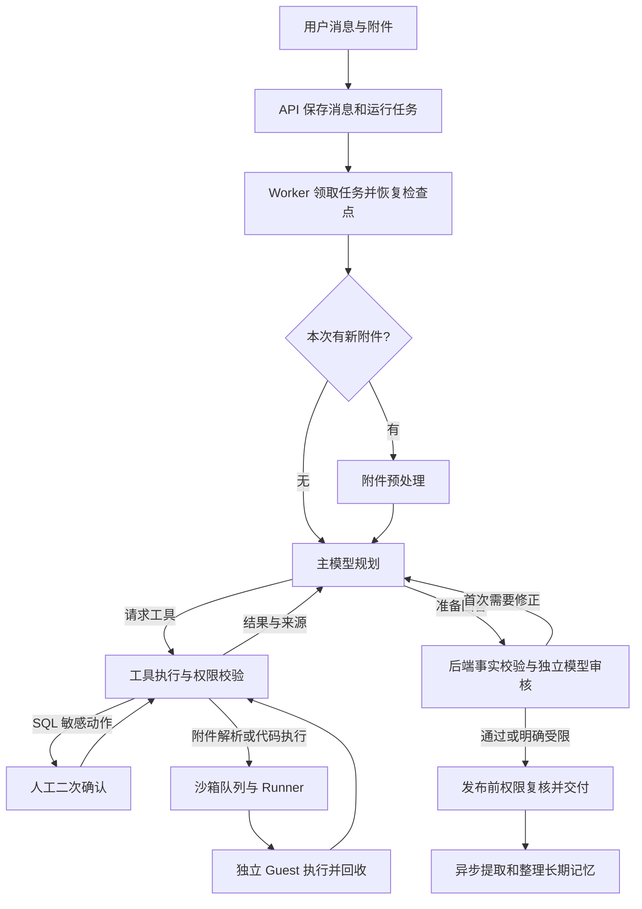
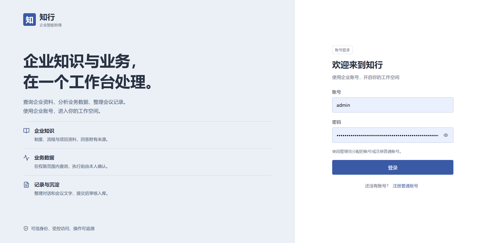
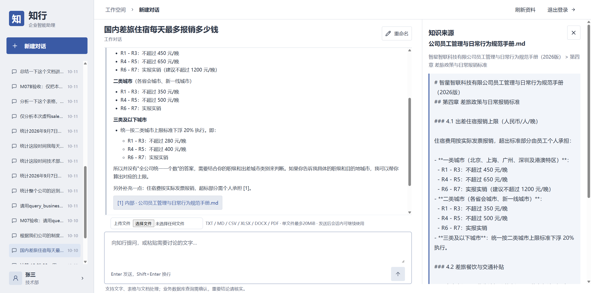
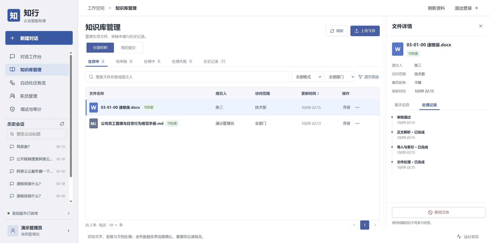
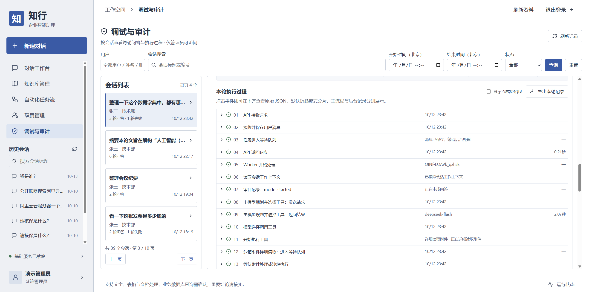

<div align="center">

# 知行 · 企业智能助理

**能查知识、处理文件、查询业务数据，并保留个人工作记忆的企业 Agent。**

[功能与架构](#功能与架构) · [快速启动](#快速启动) · [使用指南](#使用指南) · [部署与运维](OPERATIONS.md)

</div>

知行是一款面向企业日常工作与个人办公的智能助理，集企业知识问答、公开信息查询、业务数据查询和文件处理于一体。用户可以用自然语言查阅制度与资料、整理会议纪要、分析表格、生成图表或转换文档，并查看回答的资料来源、预览原文和下载处理结果。

知行支持长对话中的上下文延续，也能跨会话记住用户的个人信息、工作偏好和项目背景，让新的交流延续已有的工作线索。系统按身份控制知识与业务数据的访问范围，在敏感查询前请求人工确认，并提供答案核验与管理员会话审计，方便用户核对依据、管理员追踪处理过程。

## 功能与架构

| 模块 | 用户能做什么 | 实现特点 |
| --- | --- | --- |
| **Agent 对话** | 连续讨论、上传附件、查看引用和任务进度 | LangGraph 状态机；主模型规划和工具循环；自动切换备用模型；Markdown 格式回复 |
| **企业知识库** | 上传、审核、检索资料，预览和下载来源；分类管理生效与历史记录 | 向量检索 + 中文 BM25，RRF 融合与重排；按照部门、职级及资料有效状态约束 |
| **公开搜索** | 查询外部信息，结合公开来源回答 | 阿里云 IQS `CNLiteBasic`；搜索摘要和网页正文分开标注；关键词联网检索与企业知识库 RAG 分离 |
| **业务查询** | 自然语言查询员工、考勤、审批、工单和代码提交数据 | Text-to-SQL、SQL AST 校验、受控视图、只读数据库身份；敏感操作会触发人工二次确认 |
| **附件与沙箱** | 总结文档、多表分析、计算、绘图与常见文档转换 | 首次模型调用前强制预处理；按需详细读取；每任务一个临时 Docker 容器 |
| **短期上下文** | 保持当前会话连续性，处理较长对话 | PostgreSQL 保留原文，Redis 缓存工作上下文；按模型 token 预算自动触发上下文压缩 |
| **长期记忆** | 新会话延续个人偏好和曾经讨论的项目 | 后台提取本人原话；语义整理新增/更新/忽略；偏好和目录注入，主题详情按需进行混合检索 |
| **身份与权限** | 注册、个人资料、密码管理；管理员分配部门、职级和业务资格 | 模型工具清单先过滤，执行和结果发布再次核验；会话、附件、记忆按用户隔离 |
| **调试与审计** | 按用户会话查看每轮问答、模型用量、工具调用和实际事件 | 请求/响应、token、耗时、来源与回执可追踪；事件原地展开，关联确认和后台作业 |
| **部署与恢复** | Compose 启动服务、扩容、备份和隔离恢复 | 外置迁移、幂等种子、固定模型文件哈希；独立维护镜像 |

### 持久化队列与并发

- **对话任务**：API 写入 PostgreSQL `app_runtime.runs`。Worker 通过事务锁、`SKIP LOCKED` 与租约竞争领取，使用持久化检查点恢复。
- **沙箱任务**：`app_runtime.sandbox_jobs` 保存待执行作业。Runner 经内部 API 领取和上报，API 校验租约、保存回执并唤醒对话任务。
- **等待释放槽位**：Worker 等待沙箱时保存状态并挂起；结果就绪后可由另一 Worker 接续。Runner 为每次作业创建独立 Guest。
- **忙时排队**：副本数、每实例并发、沙箱全局和每用户额度分别配置。在队列容量和等待时限内排队，前端显示等待状态；超出限额或期限明确报错。

默认 2 个 Worker、每个 2 个槽位；2 个 Runner、每个 1 个槽位；沙箱全局并发 2、每用户并发 1。多副本目前限**同一 Docker 引擎**，目前版本暂未引入 Celery、RabbitMQ 或 Kafka。

### 上下文、记忆与混合检索

**短期上下文**包含当前会话的用户消息和 Agent 回复。Redis 是缓存，丢失后从 PostgreSQL 重建。默认在模型窗口 75% 处触发压缩，保留最近 4 轮，较早内容生成有界摘要；最终请求仍计算工具 schema、工具结果、输出预算和安全余量。原消息和压缩版本保留。

**长期记忆**分为个人信息/偏好和项目主题。偏好采用可扩展条目，后台模型结合已有条目判断新增、更新或忽略，保留来源和版本。每次请求注入有界的个人偏好及主题目录，需要细节时由模型主动调用 `search_user_memory`工具。长期记忆存储任务在后台异步进行，不影响正在进行的会话。

企业 `search_knowledge` 与个人 `search_user_memory` 是独立工具，复用向量、BM25、RRF 与重排基础设施，各有权限过滤和数据空间。Milvus 是派生索引，PostgreSQL 的有效版本和权限仍是判断依据。个人记忆不能替代企业事实的授权查询。

### 文件处理与沙箱隔离执行

聊天附件支持 **TXT、MD、CSV、XLSX、DOCX、PDF**，单文件默认 20 MiB，同时受批量大小、解析时间和资源限制。

1. 原件存 MinIO，归属、元数据和会话关联存 PostgreSQL。
2. 有新附件时先经沙箱队列预处理，返回格式、结构、长度和有限样例；大文件不会直接全文塞入模型。
3. 模型按需详细读取指定文件或范围，或者生成代码交给沙箱计算；纯文本摘要可直接由模型完成。
4. 交付正文、图表和产物文件，产物进入 MinIO，在用户权限内预览、下载。

Guest 预装 Pandas、NumPy、DuckDB、OpenPyXL、Matplotlib、Seaborn、python-docx、pypdf、Pandoc、LibreOffice Writer 和中文字体。转换效果受原件布局和库能力限制；目前版本暂不支持扫描 PDF 的 OCR、图片理解及音视频处理。

Runner 是常驻容器控制服务，Guest 是预构建执行镜像。每次作业创建新容器：断网、输入只读、无应用凭证、限制 CPU/内存/进程，完成后回收。附件和沙箱处理不弹人工确认；当前敏感确认只在业务 SQL 直接查询本地数据库时触发。

### 整体 Agent 状态机循环



## 技术栈

| 层次 | 技术 | 职责 |
| --- | --- | --- |
| 前端 | React 19、TypeScript、Vite、Lucide、React Markdown | 对话、管理、引用与产物预览 |
| API | Python 3.12、FastAPI、Pydantic、HTTPX | 身份权限、文件接口、任务接收和事件流 |
| Agent | LangGraph、自定义 PostgreSQL Checkpointer | 工具循环、挂起恢复、审核与发布 |
| 模型 | OpenAI 兼容 Chat Completions 接口 | 主模型、备用模型和审核模型分别配置 |
| 存储 | PostgreSQL 17、Redis 7.4、Milvus 2.5、MinIO | 事实与队列、缓存、检索索引、对象原件与产物 |
| 检索 | 中文 BGE、BGE Reranker、ONNX Runtime | 本地 CPU 向量和重排，与中文 BM25 混合召回 |
| 执行 | Docker Engine、Docker Compose | 服务编排与隔离任务容器 |

## 快速启动

### 1. 准备环境

- 推荐 Linux x86_64 + Docker Engine + Compose 插件；Windows 使用 Docker Desktop 的 Linux 容器模式。
- 前后端及配套服务全部通过容器运行，宿主不需要安装 Python、Node.js 或 pnpm。
- 建议从 **4 核 CPU、12 GiB 可用内存、20 GiB 可用磁盘**起步，再按文件大小和并发扩容；这是容量建议，不是性能承诺。
- 首次构建需要访问镜像源、Python/Node 包源、GitHub 分词器文件和 Hugging Face 固定模型文件；运行时需访问所配置的模型和搜索 API。

```sh
git clone https://github.com/Shawn-Z1/Enterprise-Intelligent-Assistant.git
cd Enterprise-Intelligent-Assistant
```

### 2. 初始化环境配置

Windows PowerShell：

```powershell
./scripts/init-env.ps1
```

Linux：

```sh
sh scripts/init-env.sh
```

脚本会从 `.env.example` 创建 `.env`，自动将密码占位值替换为各不相同的随机凭证，包括数据库连接密码、初始管理员登录密码、对象存储密码和沙箱内部控制令牌。这些是本套系统自己的访问凭证，不需要向外部平台注册或申请；脚本不会生成大模型或搜索服务的 API Key，也不会在终端回显密码。已有 `.env` 保留，不重新生成。

随后编辑 `.env`，填写模型与搜索供应商的 API 配置。初始管理员密码已在文件中生成，可在部署前自行设置。

| 配置 | 用途 | 要求 |
| --- | --- | --- |
| `PRIMARY_BASE_URL` / `PRIMARY_API_KEY` / `PRIMARY_MODEL` | 主模型，需支持工具调用 | 聊天必需 |
| `FALLBACK_BASE_URL` / `FALLBACK_API_KEY` / `FALLBACK_MODEL` | 主模型失败时备用 | 完整主备能力需配置 |
| `REVIEW_BASE_URL` / `REVIEW_API_KEY` / `REVIEW_MODEL` | 发布前独立模型审核 | 完整核验答案需配置 |
| `WEB_SEARCH_API_KEY` | 阿里云 IQS Key | 联网搜索需配置 |
| `INITIAL_ADMIN_PASSWORD` | 首次 `admin` 密码 | 脚本随机生成，在本机查看 |
| `PRIMARY_CONTEXT_TOKENS` / `FALLBACK_CONTEXT_TOKENS` / `REVIEW_CONTEXT_TOKENS` | 各模型上下文窗口 | 必须匹配所用实际型号 |

备用与审核可填相同 URL、Key、型号，但配置各自独立。`MODEL_OUTPUT_TOKENS` 是单次输出预算。模型与搜索调用可能产生费用。

### 3. 启动全部容器

Windows PowerShell：

```powershell
./scripts/deploy.ps1
```

Linux：

```sh
sh scripts/deploy.sh
```

脚本自动构建前后端、维护工具和 Guest 镜像，启动数据库、对象存储及 CPU 检索服务，执行结构迁移和初始数据导入，再启动 API、Worker、Runner 和 Nginx 网页服务。前端的依赖安装与静态页面构建都在镜像内完成，无需额外启动前端进程。版本回执保证重复执行不重置账号或重复导入。

打开 **[http://127.0.0.1:8080](http://127.0.0.1:8080)**，账号 **`admin`**，密码为本机 `.env` 的 `INITIAL_ADMIN_PASSWORD`。网页由 Nginx 提供，API 请求统一从同一入口转发，保留会话 Cookie、CSRF 和事件流。

### 4. 检查服务

```sh
docker compose --profile production ps
docker compose logs --tail=80 api worker sandbox-runner
```

- API 就绪检查：http://127.0.0.1:8000/api/health/ready 。
- MinIO 控制台：http://127.0.0.1:9001 ，使用 `.env` 的 `MINIO_ROOT_USER` / `MINIO_ROOT_PASSWORD`。
- 首次模型下载可能较慢，哈希验证通过后才能就绪。首次部署不能只运行 `docker compose up` 而跳过迁移与种子，请使用上述入口。

## 使用指南

### 新安装包含什么

| 内容 | 初始化行为 |
| --- | --- |
| 登录账号 | 仅一个 `admin` 管理员，不创建其他等成员账号 |
| 部门 | 管理、技术、人事、法务四个虚构部门 |
| 模拟业务 | `demo_business` 六张底表及受控视图，包含虚构员工、考勤、审批、工单和代码提交数据 |
| 知识库、聊天附件、会话、个人记忆 | 空，使用者自行添加 |
| 审计和版本回执 | 仅初始化产生的操作和迁移/种子记录 |

`demo_business` 是同一 PostgreSQL 中的独立 schema，供模拟业务SQL查询功能使用。除管理员外不关联其他登录账号，新成员需自行注册，由管理员分配部门和职级，业务工具资格单独开启。实际企业业务查询还需可信的用户/员工映射与相应受控视图，默认管理员可测试全部模拟数据。

### 首次体验路径

1. **对话**：询问“帮我列一个新员工入职清单”，观察审核与回复。
2. **知识库**：上传虚构制度文档，等待“生效中”，询问其中内容并点引用预览。普通成员提交需管理员审核。
3. **公开搜索**：配置 IQS Key 后查询公开信息，核对真实引用；未取得网页正文时只按实际摘要说明。
4. **SQL**：管理员询问“统计 2026 年 9 月 7 日至 30 日技术部所有人的代码提交次数，按人员汇总”，确认 SQL 后执行。固定样例在 2026 年 9～10 月，不使用“今天”查询。
5. **附件**：上传虚构 CSV/XLSX，统计并生成图表；或上传 MD/DOCX，整理并导出 PDF，在来源面板下载。
6. **记忆**：明确告诉 Agent 个人技术偏好，待后台提取完成后新建会话询问；项目详情按需检索。
7. **审计**：管理员选择会话和具体轮次，查看模型请求、用量、参数及实际工具回执。

## 部署边界与数据保护

- 默认仅向 `127.0.0.1` 暴露 Web、API、PostgreSQL 与 MinIO 控制台。公网服务通过 HTTPS 反向代理提供 Web，设置 `SESSION_COOKIE_SECURE=true`，正确传递可信协议和 Host，不公开存储和控制端口。
- Runner 持有 Docker socket，具备该引擎的容器控制能力。Guest 为普通 Docker，目前版本暂未启用 gVisor/runsc，不等同于虚拟机隔离；如需增强沙箱安全性可以自行修改沙箱调度方式。
- 企业 RAG、SQL 和个人记忆核验身份及有效版本。公开关键词不使用内部检索正文扩写，并做轻量输入检查。
- 模型供应商会收到任务所需的上下文和工具结果；本地存储不代表全部推理在本地。按部署方的数据使用要求选择接口。

升级、扩容、备份、恢复和问题排查见 [OPERATIONS.md](OPERATIONS.md)。

## 产品截图

**登录页：**



**对话界面：**



**知识库管理界面：**



**调试与审计界面：**


